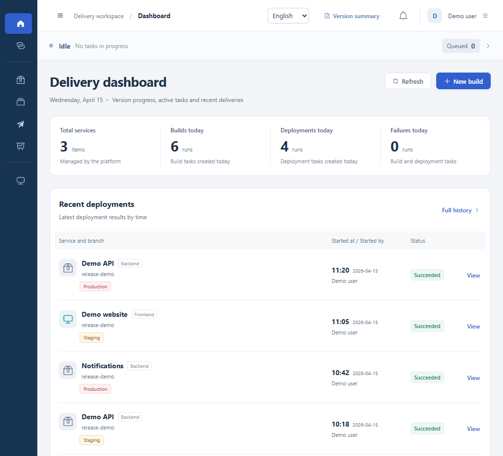

# Release Platform

[简体中文](README.md) · **English** · [Español](README.es.md)

**A self-hosted workspace for building applications, deploying services, and checking what shipped in each release.**

[Quick start](docs/quickstart.en.md) · [Connect your first service](docs/first-service.en.md) · [User guide](docs/user-guide.en.md) · [Project checks](.github/workflows/checks.yml)

Before a deployment, see the selected commit, artifact, and target nodes. Afterwards, open the same record to see who started it, which nodes passed their health checks, and where a failed task stopped.

- **Trace a build.** Select a branch and commit, then follow the build steps, logs, and resulting artifact.
- **Promote a tested artifact.** Review each target's deployment history. Production deployments require staging verification and the operator's own one-time code. Select a previous artifact to redeploy it.
- **Review a release across modules.** Group frontend, backend, and Flutter Android modules in one release plan. Services report deployment and health-check results. Android delivery uses an acknowledgment from the distributor. The release summary records what shipped, what was deferred, and what still needs confirmation.

**Current version** `0.1.0-preview.1` · Source preview. The interface supports English, Spanish, and Simplified Chinese. Start in an isolated test environment.

## Quick start

Install JDK 21, Maven 3.9, and Node.js 22 or 24, then download or clone this repository. The local preview uses H2. You can explore it before connecting a deployment server, a container registry, or an app signing key.

1. In a terminal at the repository root, build the backend, choose an initial administrator password, and start the instance in a dedicated data directory.
2. In a second terminal, install the dependencies in the `frontend/` directory and start the frontend with its proxy pointing to the local backend.
3. Open the local URL shown in the terminal. Sign in as `admin` and pair an authenticator app when prompted.

**[Follow the full setup instructions for Windows, macOS, or Linux](docs/quickstart.en.md)**

## Workspace preview

*All services, people, and records in this screenshot are fictional.*

## Where to go next

| What you want to do | Read this |
| --- | --- |
| Deploy your first test service | [Connect your first service](docs/first-service.en.md) |
| Start a build, review targets, check deployment history, or roll back | [User guide](docs/user-guide.en.md) |
| Configure storage or upload a logo | [Instance configuration (in Chinese)](docs/source-baseline.md) |
| Follow plans for generic Dockerfile builds, external CI images, and connection checks | [Roadmap (in Chinese)](docs/roadmap.md) |
| Contribute code, translations, or a bug report | [Contributing (in Chinese)](CONTRIBUTING.md) |
| Report a security issue privately | [Security policy (in Chinese)](SECURITY.md) |
