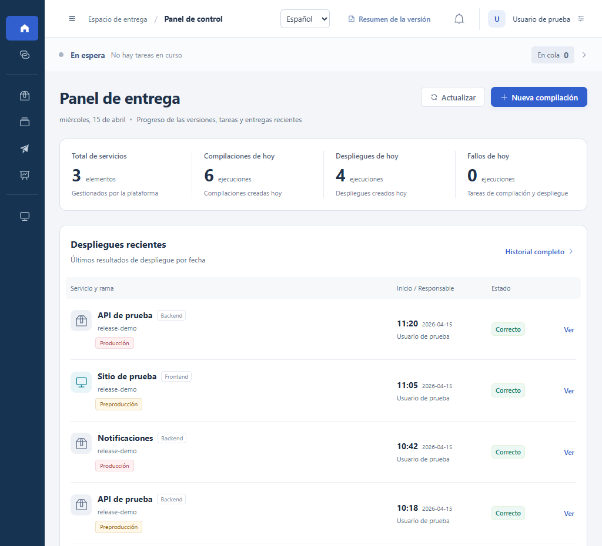

# Plataforma de despliegue

[简体中文](README.md) · [English](README.en.md) · **Español**

**Una herramienta que puedes alojar en tu propia infraestructura para compilar aplicaciones, desplegar servicios y comprobar qué se ha publicado en cada versión.**

[Inicio rápido](docs/quickstart.es.md) · [Conectar el primer servicio](docs/first-service.es.md) · [Guía de uso](docs/user-guide.es.md) · [Comprobaciones del proyecto](.github/workflows/checks.yml)

Antes del despliegue puedes revisar el commit, el artefacto y los nodos de destino. Después, el mismo registro indica quién inició la operación, qué nodos superaron las comprobaciones de estado y en qué paso se detuvo una tarea fallida.

- **Sigue una compilación.** Elige una rama y un commit. Consulta los pasos de ejecución, los registros y el artefacto generado.
- **Pasa de preproducción a producción.** Revisa el historial de cada nodo antes de confirmar. Para desplegar en producción se requiere la validación en preproducción y el código de un solo uso de quien inicia la operación. Puedes volver a desplegar un artefacto anterior desde el historial.
- **Revisa una versión completa.** Agrupa módulos de frontend, backend y Flutter Android en un mismo plan. Los servicios aportan sus resultados de despliegue y de salud. Para los paquetes Android, el distribuidor confirma la entrega. El resumen distingue lo publicado, lo aplazado y lo pendiente de confirmar.

**Versión actual** `0.1.0-preview.1` · Versión preliminar distribuida como código fuente. La interfaz está disponible en español, inglés y chino simplificado. Para empezar, utiliza un entorno de pruebas aislado.

## Inicio rápido

Instala JDK 21, Maven 3.9 y Node.js 22 o 24. Descarga o clona el repositorio. La prueba local utiliza H2. Puedes explorar el panel antes de conectar un servidor de despliegue, un registro de imágenes o una clave de firma de aplicaciones.

1. En una terminal, desde la raíz del repositorio, compila el backend, elige la contraseña inicial del administrador e inicia la instancia en un directorio de datos exclusivo para esta prueba.
2. En una segunda terminal, instala las dependencias en `frontend/` e inicia el frontend con el proxy apuntando al backend local.
3. Abre la dirección local que aparece en la terminal, inicia sesión como `admin` y vincula una aplicación de autenticación cuando se te solicite.

**[Ver los pasos completos para Windows, macOS y Linux](docs/quickstart.es.md)**

## Vista del panel

*Todos los servicios, usuarios y registros de la imagen son ficticios.*

## Siguientes pasos

| Qué quieres hacer | Documento |
| --- | --- |
| Desplegar tu primer servicio de prueba | [Conectar el primer servicio](docs/first-service.es.md) |
| Compilar, revisar destinos, consultar el historial o volver a un artefacto anterior | [Guía de uso](docs/user-guide.es.md) |
| Configurar el directorio de datos o cambiar el logotipo | [Configuración de la instancia (en chino)](docs/source-baseline.md) |
| Consultar los planes para Dockerfile genéricos, imágenes de CI externas y comprobaciones de conexión | [Hoja de ruta (en chino)](docs/roadmap.md) |
| Contribuir con código o traducciones, o informar de un fallo | [Guía de contribución (en chino)](CONTRIBUTING.md) |
| Informar de un problema de seguridad en privado | [Política de seguridad (en chino)](SECURITY.md) |
