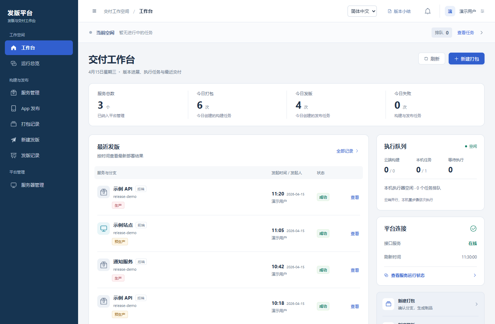

# 发版平台

 · **简体中文** · [English](README.en.md) · [Español](README.es.md)

**一个自托管的发布工作台，供团队构建应用、部署服务，并核对每个版本的交付结果。**

[快速开始](docs/quickstart.md) · [接入第一个服务](docs/first-service.md) · [使用手册](docs/user-guide.md) · [项目检查](.github/workflows/checks.yml)

发版前，你可以看到这次选的是哪个提交、哪个制品、要发到哪些节点。发版后，团队可以从同一条记录查到谁发起了操作、哪些节点通过了健康检查，以及失败发生在哪一步。

- **从提交找到制品。** 选定分支和提交后发起构建，在任务详情里查看执行步骤、日志和生成的制品。
- **从预生产发到生产。** 选包时核对各节点最近的发布记录。平台检查预生产验证结果，生产操作还需当前用户的动态码。需要回退时，可以从历史记录选择之前的制品重新发布。
- **核对整个版本。** 把前端、后端和 Flutter Android 模块放进一次版本计划。服务看部署和健康检查结果，Android 包看分发方的确认回执；收尾时记录已发布、延期和待确认的模块。

**当前版本** `0.1.0-preview.1` · 源码预览。界面支持简体中文、西班牙语和英语。适合先在独立测试环境中试用的团队。

## 快速开始

先在自己的电脑上打开工作台。准备 JDK 21、Maven 3.9 和 Node.js 22 或 24，并下载或克隆本仓库。本地体验默认使用 H2，无需准备业务服务器、镜像仓库或 App 签名资料。

1. 在仓库根目录打开第一个终端，按下方指南构建后端，设置首次管理员密码，并在独立的数据目录启动实例。
2. 另开一个终端，在 `frontend/` 安装依赖，按指南启动前端并连接本地后端。
3. 打开终端显示的本地地址，使用 `admin` 和刚设置的密码登录，按页面提示绑定动态码。

**[打开完整启动步骤（Windows / macOS / Linux）](docs/quickstart.md)**

## 工作台预览

*图中服务、人员和记录均为演示数据。*

## 接下来做什么

| 你想做的事 | 对应文档 |
| --- | --- |
| 把自己的测试服务接入平台 | [第一个服务](docs/first-service.md) |
| 发起构建、核对目标、查看记录或回退 | [使用手册](docs/user-guide.md) |
| 查看运行配置、数据目录和可选 Logo | [源码与实例配置](docs/source-baseline.md) |
| 了解通用 Dockerfile、已有镜像登记、首次接入自检的计划 | [首版路线图](docs/roadmap.md) |
| 贡献代码、译文或问题复现 | [贡献指南](CONTRIBUTING.md) |
| 私下报告可能的安全问题 | [安全说明](SECURITY.md) |
